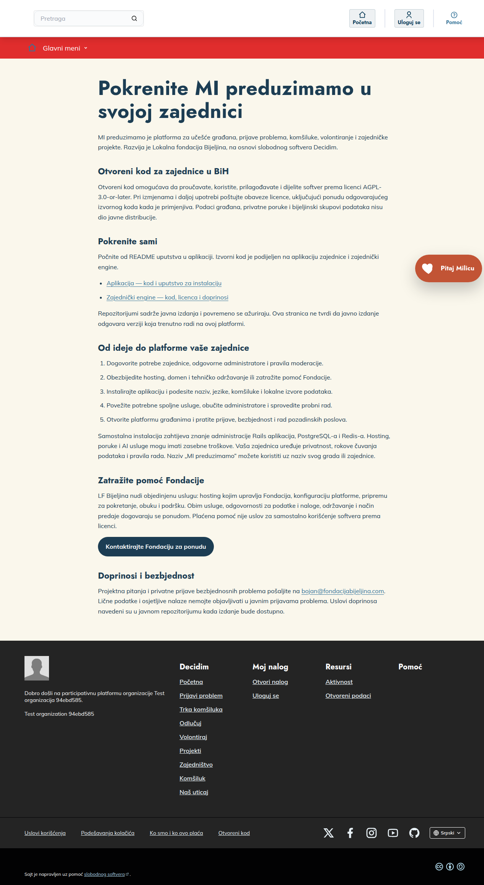

# MI preduzimamo — zajednički engine

Rails engine za funkcionalnosti platforme MI preduzimamo, zasnovane na Decidim-u, za zajednice u Bosni i Hercegovini. Referentna aplikacija obezbjeđuje instalaciju, lokalnu konfiguraciju i sadržaje.

MI preduzimamo is a Decidim-based civic platform for communities in Bosnia and Herzegovina. This repository contains its reusable Rails engine; install it through the paired community host application.

Prikaz referentne aplikacije

Snimak stranice Otvoreni kod u izmišljenoj testnoj organizaciji. Ilustruje referentnu aplikaciju; ne prikazuje podatke stvarnih građana niti potvrđuje podešenost neke zajednice.

Decidim name and logo is a registered trademark of the Associació de Software Lliure Decidim. [Politika upotrebe žiga](https://decidim.org/trademark-policy/).

## Šta sadrži

Prijave problema i obradu predmeta, komšiluke i oglasne table, bodove i priznanja, volontiranje, partnerske projekte i nenovčanu pomoć, donacije, telefonsku registraciju, poruke, Milicu, administraciju i zaštitu podataka. Pojedine oblasti zahtijevaju lokalne podatke i sopstvene ugovore/pristupne podatke za spoljne usluge. Izvorni kod ne uključuje privatne korisničke podatke ili bijeljinske GIS skupove.

## Ugradnja

Engine se za sada distribuira putem Git-a, uz tačan commit u Gemfile i Gemfile.lock referentne aplikacije; ne preuzima se sa rubygems.org. Podržana Decidim verzija je definisana u lib/decidim/bih/version.rb. Host mora uključiti decidim-core, budgets, forms, meetings, proposals i verifications u kompatibilnim verzijama.

Za prvu instalaciju koristite uputstvo referentne aplikacije. Lokalni adapteri su primjeri integracije i moraju se eksplicitno podesiti za zajednicu. Ne koristite naloge ili primaoce druge zajednice. Aplikacija i engine podržavaju srpsku latinicu, srpsku ćirilicu, bosanski i hrvatski.

## Provjere

Ruby i JavaScript testovi: `bundle exec rake test`. Rails integracioni testovi u generisanom hostu: `bundle exec rake test:rails`. Za testove obezbijedite izolovani PostgreSQL i izričito podešen REDIS_URL testne instance. Za pripremu prazne baze, extension šeme, Redis-a i tačne komande pratite [lokalne provjere engine-a](docs/PROVJERE.md). Ne koristite produkcioni .env.

## Dokumentacija

[Puni indeks vodiča](docs/README.md) povezuje javna instalaciona, razvojna i operaterska uputstva.

## Održavanje, doprinosi i licenca

Održavalac je Bojan Stojanović, za LF Bijeljina: bojan@fondacijabijeljina.com. Pogledajte CONTRIBUTING.md, SECURITY.md i CODE_OF_CONDUCT.md. Softver je pod AGPL-3.0-or-later; sačuvajte tuđe licence i napomene. Za objedinjenu uslugu hostinga, konfiguracije, obuke i podrške kontaktirajte office@fondacijabijeljina.com. Cijena i obim dogovaraju se ponudom; plaćena pomoć nije uslov za korišćenje softvera.

## Provjera javnog para

Postupak i bezbjedni preduslovi generisanog host-a opisani su u [docs/VERIFIKACIJA.md](docs/VERIFIKACIJA.md).
